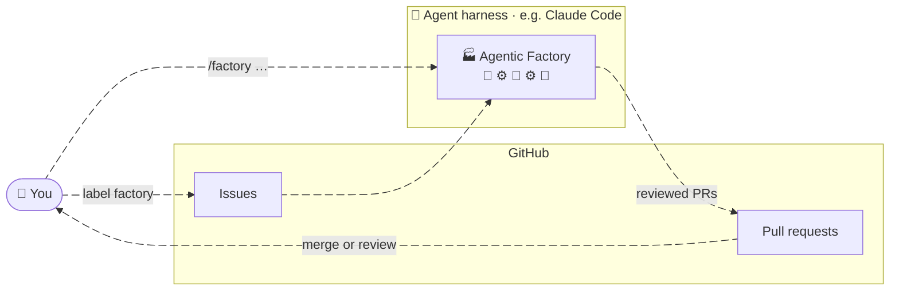

# 🏭 Agentic Software Factory

A software factory, built initially for Claude Code: specify, implement,
verify, deliver.

> [!WARNING]
> 🚧 **Work in progress:** the first version is built and tested, but not yet
> proven end to end on a real repo.

Work goes in as GitHub issues, either labelled `factory` by a maintainer or
created from `/factory <description>`. Reviewed pull requests come out. The
factory runs itself and only stops for a person when it genuinely needs one.

- **Agents do the work:** a specifier, an implementer, parallel reviewers and
  an approver.
- **Scripts keep it honest:** a Bash guard script owns all state and refuses
  illegal moves.
- **Your repo stays yours:** nothing factory-related is committed to it, and
  merging follows the repo's own settings.
- **You can watch it:** a live kanban board and a statusline segment show
  every job's progress.

- [Install](docs/INSTALL.md): installing, enabling and running the plugin.
- [Design](docs/DESIGN.md): how the factory works at runtime.
- [Repo optimisations](docs/REPO-OPTIMISATIONS.md): settings that help
  approved factory PRs land faster, and their trade-offs.
