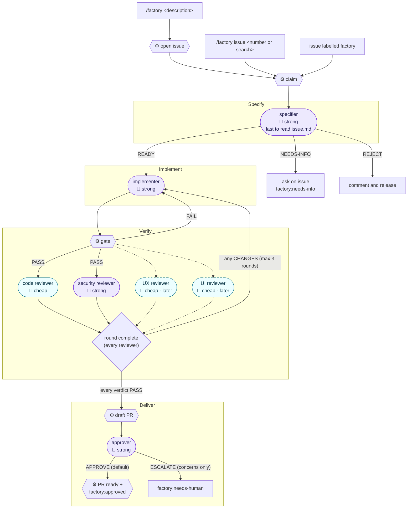

# Design

How the factory behaves at runtime. For how to work on this repo, see
[`AGENTS.md`](../AGENTS.md).

| Term | Meaning |
|---|---|
| Operator | The person running the factory. Has write access to the target repo. |
| Target repo | The repo the factory is working on. |
| Job | One issue moving through the pipeline. |
| Orchestrator | The `/factory` skill. Spawns agents and calls the guard script. |
| Guard script | `bin/factory-job`, in Bash. The only writer of factory state. |

## Principle: maximum automation

The factory runs itself. Once started, it keeps going until every job is
either finished or waiting on a human for a legitimate reason. The operator
should never have to nudge it to continue.

Humans are involved only to:

- confirm a repo's settings once, at adoption;
- decide which issues the factory may pull (a maintainer), either by applying
  `factory` directly or by reviewing a triager's `factory:candidate` proposal.
  This is the trust gate: the factory never labels its own work in, so
  untrusted issue text can't pull itself into the pipeline;
- answer a `factory:needs-info` question on the issue;
- review an escalated PR (`factory:needs-human`);
- approve or merge a PR where the repo's own settings require a human.

Everything else is the factory's call:

- **No check-ins.** The orchestrator never asks whether to continue and never
  stops with work still runnable. Progress goes in files, on the
  [board](#visibility) and in `factory-job status`, not in questions.
- **Decide and record.** An agent facing a judgement call makes the best
  decision it can, records it in its report, and carries on. Reviewers and the
  approver catch bad calls.
- **Contain failures.**
  - Transient failures (usage or rate limits, network errors) park the job,
    and it resumes automatically once the cause clears. They never escalate
    on their own. While any job is parked on a usage limit, no new jobs
    start.
  - Any other failure retries once, then escalates that one job. Other jobs
    keep running.
- **Unattended by design.** Inside the sandbox, runs need no permission
  prompts. The orchestrator stays awake by using the harness's own wake-up
  mechanisms, not by waiting for the operator.

## Pipeline

Every job passes through five stages. Several jobs can be in the pipeline at
once (see [Parallel jobs](#parallel-jobs)).

| Stage | Done by | What happens |
|---|---|---|
| Claim | Guard script | Mechanical, no judgement: verify the label, lock the issue, snapshot it, create the job. |
| Specify | Specifier (agent) | Judgement: decide whether the work can go ahead (`READY`, `NEEDS-INFO` or `REJECT`) and, if so, write the specification. |
| Implement | Implementer (agent) | Change the code in the job's worktree until the specification's acceptance criteria are met. |
| Verify | Gate (guard script), then reviewers (agents, in parallel) | The gate runs the repo's checks; reviewers judge the diff against the specification. |
| Deliver | Guard script and approver (agent) | Open the PR, decide `APPROVE` or `ESCALATE`, then hand over according to the [merge mode](#delivery). |



- **🤖 Rounded boxes are agents**, labelled with their [tier](#model-routing).
- **⚙️ Hexagons are guard-script steps:** deterministic Bash, no model.
- **Dashed boxes are reviewers planned for later.**

Each arrow is a transition made by the guard script. The orchestrator decides
what to do next from the guard script's output, never by editing state.
Running out of rounds escalates the job.

One implementer serves a job from its first round to its last. Each new round
points the same implementer at that round's review reports, so it keeps what
it learned in earlier rounds instead of starting cold.

The gate runs the checks as defined on the base branch, not the job branch, so
a branch can't change the checks it's judged by. A change to a protected path
(CI config, the checks command and the files it runs, as listed in
`config.json`) fails the gate and escalates.

## Ingress

Every job is a GitHub issue. Work enters in one of four ways.

1. **Skill prompt.** The operator runs `/factory <description>`. The text is
   trusted operator input. If it names an existing issue (by number or URL),
   the factory pulls that issue as in 2 and opens nothing new. Otherwise it
   opens an issue with the description, then pulls it as in 2.
2. **Named issue.** The operator runs `/factory issue <number | search text>`.
   A number selects that issue. Text searches open issues: one match is taken,
   several are listed and nothing is claimed. Naming an issue is the
   operator's decision to let the factory pull it, so the guard script applies
   `factory` on the operator's behalf, then claims it.
3. **Labelled issues.** `/factory run` claims open issues labelled `factory`
   that are not already claimed, and runs until the queue is empty and every
   job is finished or parked. `/factory run --watch` then keeps polling for
   new issues.
4. **Triage (optional).** The triager reads open issues that carry no
   `factory*` label and judges whether each is a good fit: small, well scoped,
   testable. Every issue it assesses gets an outcome label and a comment with
   its reasoning, so no issue is triaged twice:
   - a good fit gets `factory:candidate`, awaiting a maintainer;
   - anything that needs a person (too large, vague, risky or contentious)
     gets `factory:not-candidate`.

   The triager **never** applies `factory`; a maintainer does that. A
   maintainer re-triages an issue by removing its outcome label. Each run
   assesses at most `triage_batch` issues (default 10), oldest first.

### Labels

| Label | Decided by | Meaning |
|---|---|---|
| `factory` | Maintainer, or the operator naming an issue | Build this. |
| `factory:candidate` | Triager | Proposed for the factory; awaiting a maintainer. |
| `factory:not-candidate` | Triager | Assessed and left for a person; not re-triaged unless the label is removed. |
| `factory:in-progress` | Guard script | Claimed by the factory. |
| `factory:needs-info` | Specifier | Question asked on the issue; job parked. |
| `factory:needs-human` | Approver, or a round limit | Escalated; needs a person. |
| `factory:approved` | Approver | Approved by the factory; the repo's own process takes over. |

Agents never edit labels. An agent records its decision as its verdict, and
the guard script applies the label. The guard script creates missing labels
idempotently.

## Commands

What the operator types. The guard script behind each one is described in the
section linked.

| Command | Does |
|---|---|
| `/factory <description>` | Start a job from a description, opening an issue unless the text names an existing one. ([Ingress](#ingress)) |
| `/factory issue <number \| search text>` | Pull one issue into the factory. ([Ingress](#ingress)) |
| `/factory run` | Claim and run labelled issues until the queue is empty and every job is finished or parked. ([Ingress](#ingress)) |
| `/factory run --watch` | As `run`, then keep polling for new issues. |
| `/factory rework <job> <note>` | Send an escalated job back to its implementer with the operator's note. |
| `/factory audit` | Check models, run history and config, and recommend changes. ([Self-audit](#self-audit)) |
| `/factory audit apply` | Apply the latest audit's recommendations. |
| `/factory board` | Start the board's `localhost` server if needed and print its URL, or the board's file path if no server is available. ([Visibility](#visibility)) |
| `/factory statusline on \| off` | Add or remove the factory's statusline segment. |
| `/factory status` | Summarise jobs, warnings and recent outcomes. |
| `/factory pause \| resume` | Stop or restart the factory (the [kill switch](#limits)). |

The first command run in a repo that hasn't been adopted yet starts
[adoption](#target-repos).

## Trust boundary

- **Label provenance.** Issue forms can apply labels automatically, so the
  label alone proves nothing. Before claiming a labelled issue, the guard
  script reads the issue timeline for the most recent `labeled: factory` event
  and checks that the actor has triage, maintain, write or admin permission.
  Otherwise it refuses.
- **Organisation repos.** In an org repo, everyone with triage access can
  admit work. To narrow that, set `trusted_labellers` to a list of GitHub
  logins: only their labels (and their answers to questions) count.
- **Snapshot.** At claim time the guard script writes the issue title, body
  and comments to `issue.md` in the job folder. Later edits are ignored. Later
  comments re-enter only if their author has triage access or above (for
  example, answers to `factory:needs-info`).
- **Quoted data.** Agents that read `issue.md` treat it as data to analyse,
  never as instructions to follow.
- **The specifier is the boundary.** The specifier is the last agent to read
  the issue. It writes `specification.md` in its own words and has no push
  access. The implementer reads `specification.md` and the target repo, never
  `issue.md`.

## State

- **Location.** State lives in `$(git rev-parse --git-common-dir)/factory/`,
  which is `.git/factory/` in a normal clone and is the same from inside any
  worktree:

  ```
  .git/factory/
    config.json          per-repo settings
    audit.md             latest self-audit
    PAUSED               kill switch (presence = paused)
    board/               the live board
    jobs/<job-id>/       one folder per job: state and reports
  ```

- **Sole writer.** Only the guard script writes factory state and labels. The
  operator changes settings through it (`factory-job config set <key>
  <value>`, `factory-job pause`), never by editing files. It holds a lock
  while writing and rejects any transition not in its transition table.
- **One factory per repo.** Run one factory against a given repo at a time.
  `factory:in-progress` marks a claimed issue, and the guard script never
  claims an issue that already has it.
- **Resumable.** A restarted orchestrator rebuilds its view from the job
  folders and GitHub, then carries on. Every guard-script command is
  idempotent.
- **History kept.** Finished job folders are kept; the
  [self-audit](#self-audit) reads run history from them.

### Settings

Everything in `config.json`. Adoption sets the first group; the rest have
defaults.

| Key | Meaning | Default |
|---|---|---|
| `repo` | The GitHub repo, `owner/name`. | Detected at adoption |
| `base_branch` | Branch jobs start from and PRs target. | Detected at adoption |
| `checks` | The gate's checks command. | Detected at adoption |
| `protected_paths` | Globs a job may not change without escalating. | CI config, the checks' files and `.devcontainer/*`; when the factory works on itself, also its guard script and plugin manifests |
| `conventions` | Commit and PR conventions: `default` or `conventional`. | `default` |
| `max_parallel_jobs` | Jobs active at once. | Proposed from the plan at adoption |
| `merge_mode` | What happens after approval. Only `repo` for now. | `repo` |
| `tiers.<tier>.model`, `tiers.<tier>.effort` | Model and effort per tier. | From the harness reference file |
| `routing` | Which reviewers a job gets. | `["reviewer-code", "reviewer-security"]` |
| `max_rounds` | Rounds per job before it escalates. | 3 |
| `gate_timeout` | Seconds the checks may run. | 1800 |
| `trusted_labellers` | If set, only these logins can admit work. | `[]` (anyone with triage access) |
| `triage_batch` | Issues assessed per triage run. | 10 |
| `audit_days` | Days before an audit counts as stale. | 30 |
| `statusline` | Show the factory's statusline segment: `on` or `off`. | `off` |
| `board_port` | First port the board's server tries. | 4173 |
| `allow_host` | Allow unattended runs outside a Dev Container. | `false` |
| `audit.models_seen`, `audit.last_run` | Written by `audit apply`, never set by hand. | — |

`factory-job config set` refuses unknown keys and invalid values.

## Parallel jobs

- **Limit.** At most `max_parallel_jobs` jobs are active at once; the rest
  wait in the queue. The guard script enforces the limit.
- **Sizing.** At adoption, the harness layer detects the billing plan and the
  guard script proposes a limit, which the operator confirms with the other
  settings:

  | Plan | Limit |
  |---|---|
  | API billing | 2 |
  | Pro | 2 |
  | Max | 3 |
  | Ultra | 4 |
  | Unknown | 2 |

  The operator can change it at any time (`factory-job config set
  max_parallel_jobs <n>`). The [self-audit](#self-audit) re-detects the plan
  and recommends a new limit if it has changed.
- **Isolation.** Each job has its own worktree, branch, job folder and
  implementer, so parallel jobs never share files on disk. Agents from
  different jobs never share context.
- **No blocking.** The orchestrator runs agents in the background. When any
  agent finishes, it advances that job and starts the next queued job if a
  slot is free.
- **Base drift.** Before opening the PR, the guard script rebases the branch
  onto the latest base and re-runs the gate. A conflict, for example from a
  parallel job that touched the same files, returns to the implementer once,
  then escalates.

## File contracts

These are the harness-neutral interface. Any harness whose agents can read
and write files can play an agent's part.

- Each agent writes exactly **one report** in its job folder and replies to
  the orchestrator with one line. Code changes made by the implementer go to
  the worktree, not the job folder.
- Line 1 is a job header identifying the job and agent. Line 2 is the verdict,
  always `VERDICT: <value>`. The guard script parses only those two lines; the
  rest of the report is free-form, for the next agent and the operator.

### Job folder

```
jobs/42-null-title/
  job.json                 state (guard script)
  issue.md                 issue snapshot at claim time (guard script)
  specification.md         specifier
  implementation.md        implementer; the code itself is in the worktree
  round-1/
    gate.md                gate result (guard script)
    code-review.md         code reviewer
    security-review.md     security reviewer
  round-2/ …
  approval.md              approver
```

The job id is the issue number and a slug of its title. Its worktree is
`.worktrees/<job-id>/`.

### Verdicts

| Report | Verdict values | Also carries |
|---|---|---|
| `specification.md` | `READY` / `NEEDS-INFO` / `REJECT` | `READY`: change type (for the branch name) and acceptance criteria. `NEEDS-INFO`: the question to post. `REJECT`: the reason. |
| `implementation.md` | `DONE` / `BLOCKED` | What changed, and how each acceptance criterion was checked. `BLOCKED`: why. |
| `round-N/*-review.md` | `PASS` / `CHANGES` | `CHANGES`: each requested change. `PASS`: any reservations. |
| `approval.md` | `APPROVE` / `ESCALATE` | `ESCALATE`: each concern. |
| `audit.md` | `CURRENT` / `CHANGES-RECOMMENDED` | Each recommendation's evidence, reason and command. |

### Formats

Every report starts with exactly these two lines:

```
<!-- factory job=42-null-title agent=reviewer-security round=1 -->
VERDICT: CHANGES
```

- The header must name the job and agent it was written for. The
  implementer's and reviewers' headers must also name the current round, so
  a report left over from an earlier round never counts.
- Fields the guard script reads are lines of the form `NAME: value`
  directly after the verdict:

  | Field | In | Used for |
  |---|---|---|
  | `TYPE:` | `specification.md` (`READY`) | The branch name, e.g. `fix/42-null-title`. |
  | `TITLE:` | `implementation.md` | The PR title. The rest of the report is the PR body. |
  | `MODELS-SEEN:` | `audit.md` | Comma-separated model ids, recorded by `audit apply`. |
  | `COMMAND:` | `audit.md` | One `factory-job config set <key> <value>` per recommendation. `audit apply` refuses anything else. |

- For `NEEDS-INFO` and `REJECT`, the text after the verdict is posted on the
  issue as written.
- The guard script writes `gate.md` itself, with `agent=gate` and `PASS` or
  `FAIL`.

## Target repos

- **No factory files.** No factory config, state, prompts or tooling are
  committed to a target repo. The only commits are the change itself.
- **Branches.** Names follow the target repo's own convention, read from its
  `AGENTS.md` or contributing docs. The default is
  `<type>/<issue-number>-<slug>` (e.g. `fix/42-null-title`), where `<type>` is
  the change type (`feat`, `fix`, …) recorded in `specification.md`. Never use
  a `factory/` prefix or a name that matches a release branch pattern.
- **Conventions.** One setting, `conventions`, covers commit messages, PR
  titles and PR bodies:
  - `default` (default): whatever the target repo documents (its `AGENTS.md`,
    contributing docs and PR template). Anything it doesn't document falls
    back to `conventional`.
  - `conventional`: always Conventional Commits, so semantic-release and
    changelogs work unchanged. PR bodies give a summary, the linked issue
    (`Closes #42`), the acceptance criteria and how they were tested.

  Squash merges use the PR title as the commit message, so the PR title must
  describe the whole change in the commit convention.
- **Worktrees.** One per job under `.worktrees/`, ignored by appending to
  `.git/info/exclude`. Disposable: every round is pushed.
- **Main checkout untouched.** The factory never checks out, edits or commits
  in the operator's main checkout. All work happens in worktrees.
- **Reading the repo.** Agents read the target repo's `AGENTS.md`. If there is
  none, they fall back to `CLAUDE.md`, then the README, contributing docs and
  CI config.
- **Adoption.** On the first `/factory run` in a repo, the factory detects the
  base branch, checks command, conventions and parallel limit, and asks the
  operator to confirm them once. The guard script then writes `config.json`.

## Delivery

- The approver approves by default once every review has passed. It escalates
  only for a concrete concern, such as a risky area (authentication, data
  migrations, payments), a specification it isn't confident in, or a
  reviewer's pass that came with reservations. It names each concern in
  `approval.md`.
- On `ESCALATE`, the PR is marked ready and labelled `factory:needs-human`.
  It is never merged automatically.
- On `APPROVE`, the PR is marked ready and labelled `factory:approved`. What
  happens next depends on `merge_mode`:
  - `repo` (the only mode for now): the factory makes no merge call and
    changes no merge setting. The PR is merged however the repo already
    works, by a maintainer, a merge queue, or automation the repo has set up
    (for example, auto-merging PRs labelled `factory:approved` once CI
    passes).
  - [`docs/REPO-OPTIMISATIONS.md`](REPO-OPTIMISATIONS.md) describes repo optimisations that
    let approved factory PRs merge with less waiting, and their trade-offs.

## Limits

These stop work:

- **Round limits.** At most 3 review rounds per job, then escalate.
- **Kill switch.** The guard script refuses to start or advance any job while
  `.git/factory/PAUSED` exists. Removing the `factory` label from an issue
  cancels its job at the next transition.

This never stops work:

- **Cost reporting** is best-effort and off the critical path. A failure to
  look up or record cost is logged and ignored.

## Sandbox

- Unattended runs must happen inside a Dev Container. The guard script
  detects one from `REMOTE_CONTAINERS`, `CODESPACES`, `/.dockerenv` or
  `/run/.containerenv`. On the host it refuses to run jobs unless the operator
  opts out explicitly, for one command (`FACTORY_ALLOW_HOST=1`) or for the
  repo (`allow_host`).
- The GitHub token is the least privilege that works: the target repo only,
  with contents, issues and pull requests access. It comes from the
  environment, never from a file.
- The guard script needs only Bash, `git`, `gh`, `jq` and coreutils, so no
  extra runtime is required in the container.

## Visibility

The factory is meant to be watched, not just run. Two views show its state,
and neither ever changes it.

### Board

A lightweight kanban board, one card per job:

| Column | Holds |
|---|---|
| Queued | Jobs waiting to start, including those being claimed. |
| In progress | Jobs in specify, implement, verify or deliver. |
| Human review | Jobs waiting on a person: `factory:needs-info`, `factory:needs-human`, or an approved PR the repo needs a person to merge. |
| Done | Merged, rejected or cancelled. |

- **Cards, with progressive disclosure.** At a glance a card shows only its
  job id and title, one stage pill, small status pills for that stage's agent
  tasks (e.g. one per reviewer: running, passed, changes requested), and a
  badge if parked. Everything else waits until the card is opened: issue and
  PR links, the agent and its tier, round count, time in stage, and the
  reports.
- **Header.** Running or paused, active jobs against the limit (e.g. 2 / 3),
  and any warnings (audit due, jobs parked).
- **Updated live.** The board is one static page in `.git/factory/board/`,
  with no build step. The guard script rewrites its data file on every
  transition, and the page picks up the change within a few seconds.
- **Works however the repo is mounted.** The operator may work in a local
  clone, a Dev Container bind-mounted from the host, a container cloned into
  a volume, Codespaces or a remote host. The board must work in all of them:
  - **Served on `localhost` (preferred).** `/factory board` starts a small
    static server for `.git/factory/board/` if one isn't already running,
    bound to `localhost` only, and prints its URL. VS Code forwards the port
    from containers and Codespaces automatically.
  - **Detected, not required.** The server is the first one available of
    `python3` (standard library only), `node` (inline, no packages) and
    `busybox httpd`. The factory installs nothing.
  - **Opened from disk as a fallback.** If none is available, `/factory
    board` prints the `file://` path and says what to install for the server.
    Opening from disk works only where the browser can see the files (a
    local clone or a bind mount).
  - **The page says when it's in fallback mode.** Opened from disk, the board
    shows a small, dismissible note: it's running without a server, and
    updates may be less smooth. The note gives the commands to fix that:
    install one of the servers (e.g. `sudo apt-get install -y python3`), then
    run `/factory board` and open the URL it prints.
- **Why the data file is JavaScript.** Browsers block `fetch` for pages
  opened from `file://`, but they still load `<script>` tags. So the data file
  is a script that sets one variable, and the page re-loads it by adding a
  fresh `<script>` tag. That one mechanism works both served and from disk.
  Don't turn it into JSON read with `fetch`: that breaks the fallback.
- **Safe.** Issue titles and report text are untrusted, so the page renders
  them only as text, never as HTML.

### Statusline

In harnesses with a statusline, the factory adds a short segment after the
operator's own, such as `🏭 2/3 · #42 implement · #45 verify r2 · ⚠ 1 needs
human`. It shows only in a repo the factory has adopted, and reads local
state only, so it stays fast.

- **Append, never replace.** Any existing statusline is kept, runs first and
  is shown unchanged.
- **Easy on and off.** `/factory statusline on` and `off` add and remove the
  factory segment. The harness wiring is installed once; after that, on and
  off only flip a setting. The segment text comes from the guard script, so
  it's the same in every harness.

## Model routing

Agents are routed by tier, not by model id:

| Tier | Means | Used for |
|---|---|---|
| `strong` | A high-quality model at high effort. | Specifier, implementer, security reviewer, approver, auditor |
| `cheap` | A medium-quality model at medium effort. | Triager; code, UX and UI reviewers |

Each tier's model and effort can be overridden per repo (e.g.
`factory-job config set tiers.strong.model <model>`). Each harness's reference
file maps tiers to concrete models and effort levels.

Reviewers are chosen by risk and by which areas of the code the change
touches; the routing table lives in `config.json`, not in prompts. The
reviewers in a round run in parallel, and the round is complete only when
every routed reviewer has written its report.

## Self-audit

The factory periodically checks its own setup. It recommends and warns, but
the operator decides.

- **Audit.** `/factory audit` runs the auditor. It writes
  `.git/factory/audit.md` with `VERDICT: CURRENT` or
  `VERDICT: CHANGES-RECOMMENDED`, covering three areas:
  - **Models:** the models currently available through the harness, compared
    with the tier mapping and effort levels in use.
  - **Run history:** job outcomes since the last audit. That means escalation
    and rejection rates and their reasons, review rounds used, gate failures
    and parking. The auditor recommends changes to tiers, reviewer routing or
    round limits where the history supports them.
  - **Config drift:** whether `config.json` still matches reality: the checks
    command still passes on base, protected paths still exist, the
    conventions haven't changed, and the parallel limit still suits the
    detected plan.

  For each recommendation it gives the evidence, the reason, and the exact
  `factory-job config set` command.
- **Apply.** `/factory audit apply` applies the latest audit's
  recommendations through the guard script. Nothing changes until the
  operator runs it.
- **Warn.** At the start of every run the harness layer passes the list of
  available model ids to the guard script. The guard script warns, on the
  board, in `factory-job status` and at the start of each run, when there are
  model ids it didn't see at the last audit, or when the last audit is older
  than `audit_days` (default 30). This check needs no model and costs no
  tokens.
- **Never blocking.** The audit is advisory. A failure to list models or read
  history is logged, and work carries on with the current config.

## Future

Planned, but not designed in full yet. Each fits the design above without
changing it.

- **Lane 2: spec-kit.** For larger features. The operator writes and commits
  a spec interactively with spec-kit, then labels an issue `factory` and
  `factory:speckit`, pointing at the spec directory. The factory skips the
  specify stage, and never runs `specify init` or `specify` itself. Unlike the
  default lane, the approver always escalates here: Lane 2 changes are larger
  and their specs come from a separate tool, so a human checks every result
  until there's evidence it can be trusted. Once spec-kit is integrated, its
  own artefacts (clarifications, analysis findings, checklists) should help
  decide when a human is really needed. Alternatively, the operator may choose
  which spec-kit steps get human review, or under what conditions. **To be
  decided.**

  Known pitfalls to design around:
  - **Preflight.** Offer Lane 2 only in repos that already have `.specify/`.
    Check that the spec directory exists on the base branch and has no
    `[NEEDS CLARIFICATION]` markers left.
  - **Stages.** Generate `tasks.md` if it's missing. Treat spec-kit's analyse
    step as a gate, where critical findings escalate. The implementer works
    through `tasks.md` from the top, ticking tasks off. Spec-kit's converge
    step acts as a reviewer: unbuilt work counts as changes requested.
  - **Feature numbers** come from scanning `specs/` in the checkout, so two
    worktrees can pick the same number. If the factory ever creates specs,
    pass the feature directory explicitly.
  - **Spec-kit's git hooks** create branches and can auto-commit, which
    fights the factory's own branches. Disable or neutralise them in factory
    runs.
  - **Pin the spec-kit version** each repo was tested with, and warn on a
    mismatch.
  - **Never parse spec-kit's output formats directly**, because they change.
    Agents that wrap spec-kit still write factory-format reports.
  - **One PR per task** (spec-kit's task-to-issue fan-out) is tempting, but
    tasks are usually too small and too inter-dependent. Leave it out.
- **Triage** (ingress 4). The guard script already reserves the triager's tier
  and the `factory:candidate` and `factory:not-candidate` labels.
- **UX and UI reviewers.** They need a browser CLI (to be chosen), not an MCP
  server. Their routing names and tier are already reserved.
- **Risk-based routing.** Choose reviewers by the change's risk and the areas
  it touches, e.g. a low-risk change with no UI gets the code reviewer only.
  Until then, `routing` is one list for every job.
- **Watching CI after the PR opens.** Failures go back to the implementer in
  one batch per round, up to 3 CI-fix rounds.
- **`factory` merge mode.** The factory merges an approved PR itself once it
  is fully resolved: CI green and every review comment addressed. It depends
  on watching CI.
- **Budget check** before starting each job, parking the queue when usage is
  over a configured limit (for example, an operator-supplied usage-check
  command).
- **Other harnesses.** Port the orchestrator by adding a reference file and
  translating agent frontmatter; the guard script and file contracts don't
  change. A cheap reviewer could then run on a local model.
- **Overlap detection.** Specifications list the paths they expect to touch,
  and a job that overlaps an active one waits. Until then, worktrees keep
  parallel jobs apart on disk and the rebase before the PR catches conflicts.
- **Several factories per repo.** Needs a claim protocol that tells machines
  apart, since they may share a GitHub account.
